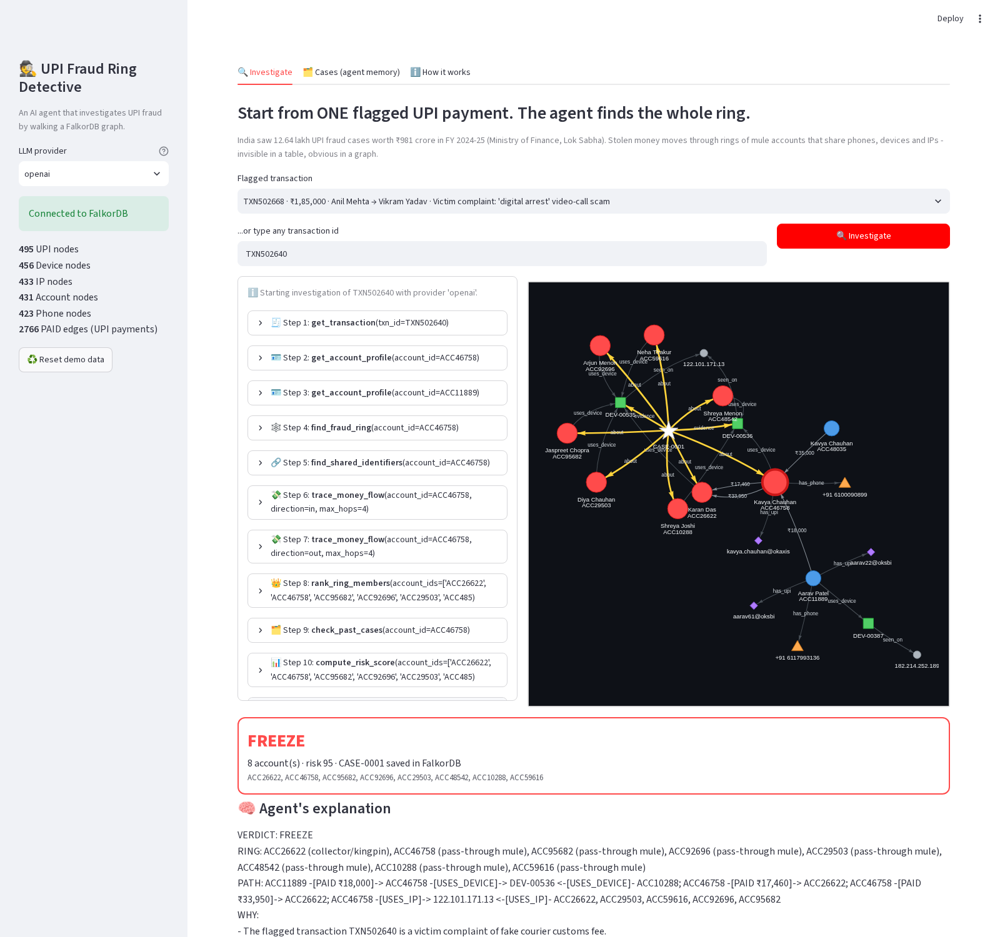
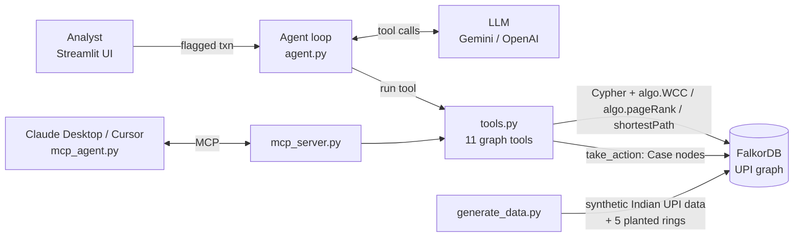

# 🕵️ UPI Fraud Ring Detective

*Submitted as Sherlock Pay*

🔴 [Live demo](https://upi-fraud-detective.streamlit.app) · 🎥 [Demo video](https://youtu.be/_oTZMlVvnbI) · 📝 [Blog post](https://dev.to/ishika29tech/we-gave-an-ai-agent-one-185000-upi-payment-it-walked-the-graph-and-found-the-mule-ring-2dpl)


**An AI agent that starts from ONE flagged UPI payment, walks a FalkorDB graph hop by hop, uncovers the whole mule ring, freezes it, and shows exactly why.**

Built for **Graph Hacks: Context for AI Agents** (WeMakeDevs × FalkorDB), **Track 1: Agents That Act on Connected Data**.



---

## The problem

- India recorded **12.64 lakh UPI fraud cases worth ₹981 crore in FY 2024-25**
  (Ministry of Finance reply in Lok Sabha, reported by [BOOM](https://www.boomlive.in/web-stories/india/upi-fraud-cases-and-losses-rise-over-five-years-finance-ministry-tells-lok-sabha-2755)).
- Stolen money is moved through **mule accounts**. In the Home Minister's words: *"Mule accounts are big hurdles in curbing cyber crimes"*
  ([PIB, I4C–RBIH MoU](https://www.pib.gov.in/PressReleasePage.aspx?PRID=2260277)).

One flagged payment in a table looks harmless: "₹18,000 from Aarav to Kavya". But Kavya's account is 25 days old,
logs in from the same phone as 7 other new accounts behind one IP, and forwards every rupee within 20 minutes to a collector.
**That only shows up when you follow the connections, which is a graph problem.**

## What it does

1. An analyst picks a flagged transaction (victim complaint or bank rule).
2. The **agent** (Gemini by default, or OpenAI) decides which **graph tool** to call next: profile the account, find shared phones/devices/IPs,
   follow the money several hops, run **connected components** to get the whole ring, **PageRank** to find the kingpin, check **past cases**.
3. Every tool is a Cypher query or a FalkorDB algorithm. The UI draws the graph **growing hop by hop**.
4. The agent **acts**: it writes a `Case` node into FalkorDB and sets accounts to `FROZEN` / `UNDER_REVIEW` / `FLAGGED`, or `CLEAR` for innocent people.
5. It **explains** itself: verdict, ring members and their roles, the exact graph path, and every Cypher query it ran.

## How it meets the Track 1 judging focus

| Judging focus | Where it is in this project |
|---|---|
| **Multi-hop reasoning** | `trace_money_flow` follows `PAID*1..6` variable-length paths with a time-gap rule (rapid layering). `find_shared_identifiers` goes Account → Device → IP → Device → Account (4 hops). The agent chains 10–14 tool calls per case. |
| **Graph queries & algorithms as agent tools** | `algo.WCC` (connected components → the ring), `algo.pageRank` (collector / kingpin), `shortestPath` (how two accounts connect), plus 8 Cypher tools. See `tools.py`. |
| **Tool selection through MCP** | `mcp_server.py` serves all 11 tools over MCP (works in Claude Desktop / Cursor). `mcp_agent.py` is an agent that **discovers** the tools with `list_tools` and calls them with `call_tool`. |
| **Actions based on what the graph shows** | `take_action` writes `Case` nodes with `ABOUT` and `EVIDENCE` edges and changes account status. Innocent look-alikes (a family sharing a tablet) get `CLEAR`. |
| **Explainable results** | Each step shows the tool, its arguments, the result and the **exact Cypher**. The risk score lists its reasons (for example "+25 device shared with 5 other accounts"). The final answer gives the PATH. |
| Bonus: memory | `Case` nodes stay in the graph. `check_past_cases` lets a later investigation see "this device was already in CASE-0003". |

## Results (on the synthetic dataset)

`python evaluate.py` runs a full investigation for every flagged transaction and compares the result with the planted answer key:

| Mode | Ring members caught (FREEZE/ESCALATE) | False alarms on innocent accounts |
|---|---|---|
| LLM agent (tested with OpenAI `gpt-4.1-mini`) | 27 / 28 | 0 |
| Offline rule-based mode (no LLM) | 27 / 28 | 0 |

The 28th account is the "boss" of the one-phone ring: the agent marked it FLAG (watch) rather than FREEZE.
Gemini (`gemini-3.1-flash-lite`) was also checked end to end on the one-phone ring. It froze the 4 mules and flagged the collector.
Run `python evaluate.py` with your Gemini key to get the full table with Gemini.

## Architecture



## Graph schema

```
(:Account {id, holder, bank, city, opened_on, kyc, is_merchant, status})
(:UPI {vpa})            e.g. rohan.sharma@okaxis
(:Phone {number})   (:Device {id, model})   (:IP {addr, isp, city})
(:Case {id, action, risk_score, reason, txn_id, created_at})      <- written by the agent

(Account)-[:HAS_UPI]->(UPI)
(Account)-[:HAS_PHONE]->(Phone)
(Account)-[:USES_DEVICE]->(Device)-[:SEEN_ON]->(IP)
(Account)-[:PAID {txn_id, amount, ts, flagged, flag_reason}]->(Account)
(Case)-[:ABOUT]->(Account)        (Case)-[:EVIDENCE]->(Phone|Device)
```

Planted patterns: **device farm** (fan-in), **layering chain** (5 hops in about 30 minutes), **fan-out structuring** (payments just under ₹10,000),
**one phone with many UPI IDs**, and a **fake merchant**. There are also 2 traps: a family sharing a tablet, and a big but normal rent-style payment.

## Agent tools

| Tool | What it does | FalkorDB feature |
|---|---|---|
| `get_transaction` | payer, payee, amount, flag | pattern match on edge property |
| `get_account_profile` | age, KYC, UPI IDs, phones, devices, IPs, money in/out | 1–2 hop match |
| `find_shared_identifiers` | other accounts on the same phone / device / IP | 2–4 hop match |
| `trace_money_flow` | follow money in/out up to 6 hops, rapid chains only | variable-length paths `PAID*1..k` + list predicates |
| `find_fraud_ring` | whole identity ring | **`algo.WCC`** (connected components) |
| `rank_ring_members` | collector / pass-through / cash-out roles | **`algo.pageRank`** |
| `shortest_path_between` | how two accounts are linked | **`shortestPath`** |
| `check_past_cases` | memory of earlier cases | `Case` nodes |
| `compute_risk_score` | 0–100 score with written reasons | 14 small feature queries |
| `take_action` | FREEZE / ESCALATE / FLAG / CLEAR + Case node | writes to the graph |
| `list_flagged_transactions` | the queue | |

---

## Quick start (local, about 10 minutes)

You need **Python 3.10+** and either **Docker Desktop** or a free **FalkorDB Cloud** instance.

```bash
git clone https://github.com/<your-username>/upi-fraud-ring-detective.git
cd upi-fraud-ring-detective

# 1. Start FalkorDB (skip if you use FalkorDB Cloud)
docker compose up -d

# 2. Python packages
python -m venv .venv
# Mac/Linux: source .venv/bin/activate      Windows: .venv\Scripts\activate
pip install -r requirements.txt

# 3. Settings: copy the example and paste your Gemini key
cp .env.example .env          # Windows: copy .env.example .env

# 4. Create the graph (about 2,200 nodes and 4,600 edges)
python generate_data.py

# 5. Run the app (opens http://localhost:8501)
streamlit run app.py
```

- **No API key yet?** Pick `offline` in the sidebar. It runs the same tools with fixed rules.
- **Using FalkorDB Cloud instead of Docker?** Create a free instance at [app.falkordb.cloud](https://app.falkordb.cloud),
  then put its host, port, username and password in `.env`.
- **See the raw graph:** open FalkorDB Browser at http://localhost:3000 and run
  `MATCH p=(c:Case)-[]->() RETURN p` after an investigation.
- **Command line:** `python agent.py TXN502640` or `python agent.py TXN502640 offline`.
- **Tests:** `pytest -q` (offline mode must catch the rings and not freeze the innocent family).

## Use the tools from Claude Desktop / Cursor (MCP)

```bash
mcp dev mcp_server.py          # opens the MCP Inspector in your browser to try each tool
python mcp_agent.py TXN502718  # our agent, discovering and calling tools over MCP
```

Claude Desktop → Settings → Developer → Edit config:

```json
{
  "mcpServers": {
    "upi-fraud-detective": {
      "command": "/FULL/PATH/upi-fraud-ring-detective/.venv/bin/python",
      "args": ["/FULL/PATH/upi-fraud-ring-detective/mcp_server.py"]
    }
  }
}
```

(Windows: `C:\\FULL\\PATH\\upi-fraud-ring-detective\\.venv\\Scripts\\python.exe`.) Restart Claude and ask:
*"List flagged transactions and investigate the digital-arrest one."*

## Deploy (free)

1. **FalkorDB Cloud** free instance → copy host, port, username, password.
2. Run `python generate_data.py` once with those values in `.env`, so the cloud graph gets the data.
3. **Streamlit Community Cloud** → New app → pick this repo and `app.py` → Advanced settings → Secrets:
   ```toml
   LLM_PROVIDER = "gemini"
   GEMINI_API_KEY = "..."
   FALKORDB_HOST = "..."
   FALKORDB_PORT = "..."
   FALKORDB_USERNAME = "..."
   FALKORDB_PASSWORD = "..."
   ```

## Project structure

```
db.py               connection to FalkorDB (one function: run_query)
generate_data.py    synthetic Indian UPI data + planted fraud rings -> FalkorDB
tools.py            the 11 agent tools (Cypher + graph algorithms)
agent.py            the agent loop (Gemini / OpenAI / offline)
app.py              Streamlit UI with live graph
mcp_server.py       the same tools served over MCP
mcp_agent.py        an agent that uses the tools through MCP
evaluate.py         scores the agent against the answer key
tests/              pytest checks
LEARN.md            how agents, tools, multi-hop and MCP work, using this code
```

## Limitations and next ideas

- The data is synthetic. Real deployments would stream transactions into FalkorDB and attach device fingerprints from the UPI app.
- The risk score is a transparent rulebook, not a trained model. A GNN or gradient-boosted model could be added as one more tool.
- Ideas: a real-time watcher that triggers the agent on every new flagged payment, an analyst approve/reject loop, and multi-bank graphs (one FalkorDB graph per bank).
